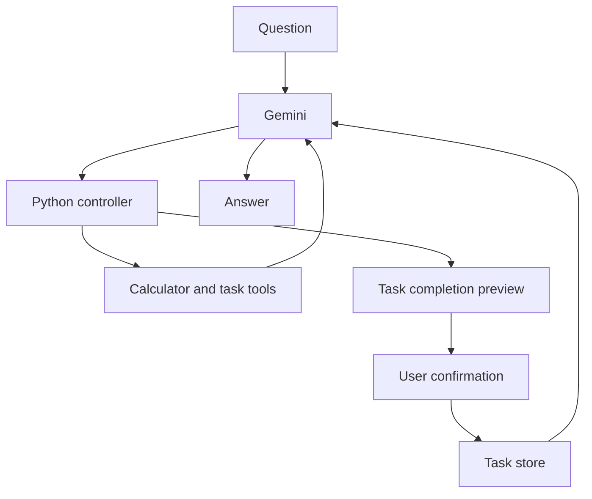

# Project 03: Study Planner Agent

An assistant that calculates study time, reads a small task list, makes a daily
plan, and asks before marking work complete. It builds on Project 02's Gemini
chatbot and adds a visible tool-calling loop.

The four entry points stay available so each concept can be explored separately.

| Version | Main idea | Run from the repository root |
| --- | --- | --- |
| V1 | Test a Python tool directly | `python day-03-ai-agent/v1.py` |
| V2 | Let Gemini request the calculator | `python day-03-ai-agent/v2.py` |
| V3 | Combine calculation, task retrieval, and planning | `python day-03-ai-agent/v3.py` |
| V4 | Confirm updates; use a terminal or browser interface | `python day-03-ai-agent/v4.py` |

## How the agent works



Gemini selects a tool and supplies arguments. The application checks them
against an approved registry, executes the function, and sends its result back.
The tools do the arithmetic and read task facts. Gemini explains the results.
The browser confirms updates after the answer; its next model turn receives
the actual update result.

## V1: a tool without a model

From the repository root:

```bash
python day-03-ai-agent/v1.py
python -m unittest discover -s day-03-ai-agent -p 'test_*.py' -v
```

Try 90 minutes and 5 days. The result is 450 minutes, or 7.5 hours.
Try a negative value too; the function should reject it.

The calculation belongs to Python. Later, the model will request this same
function using structured arguments. Keeping the calculation separate makes
it easier to tell a tool bug from a model mistake.

## V2: Gemini chooses the tool

Use Python 3.10 or newer. From the repository root, activate your virtual
environment and install the dependencies:

```bash
python -m pip install -r day-03-ai-agent/requirements.txt
```

On macOS, enter your key without adding it to shell history:

```bash
read -s -p "Gemini API key: " GEMINI_API_KEY; echo
export GEMINI_API_KEY
python day-03-ai-agent/v2.py
```

The default is `gemini-3.5-flash-lite`, matching Project 02. You can select
another available model with `export GEMINI_MODEL="your-model-id"`.

Ask: "I can study 90 minutes each day for 5 days. How much time is that?"
The terminal shows the tool result and then Gemini's explanation.

`agent.py` describes the function with a JSON schema and disables automatic
execution in the SDK. The controller checks the name and arguments, runs
the calculator, and sends the result back. It preserves the model's original
response parts and call IDs, which matter when continuing a Gemini tool call.
It stops after five tool rounds or eight tool executions per question.

`/clear` resets conversation history. `/exit` closes the client.

The scripted tests exercise the real controller with a fake SDK boundary;
they do not contact Gemini or prove how reliably the live model chooses tools.

## V3: read tasks and make a plan

```bash
python day-03-ai-agent/v3.py
```

Ask: "I have 90 minutes each day for 5 days. What is pending, and how should
I use that time?" Then ask a follow-up such as "What if I only have two days?"

`tasks.json` is a sample list. Each entry has an ID, title, estimate in minutes,
and a `done` flag. `list_pending_tasks` reads unfinished entries.
`build_study_plan` fills each day in file order, splitting a long task across
days when necessary. It reports work that does not fit and unused time.
The model explains this calculated plan; it does not invent task estimates.

The task reader validates JSON before using it. Task text is treated as data.
V3 reads the sample file and never marks anything complete.

## V4: confirm changes

```bash
python day-03-ai-agent/v4.py
```

Ask: "Mark tool-loop as complete." The terminal shows the task title and ID.
Only typing `yes` confirms the update. An empty answer or any other reply
cancels it. The model cannot pass a `confirmed` argument to approve itself.

V4 creates `tasks.local.json` beside the sample file on its first terminal run.
It saves confirmed changes there, leaving `tasks.json` intact. The local copy
is ignored by Git. Edit its estimates and titles to fit your own study plan.
This file is intended for one local process at a time, not concurrent users.

Start the browser interface from the same configured terminal:

```bash
python -m streamlit run day-03-ai-agent/web_app.py
```

Use **Confirm completion** or **Cancel** for each proposed update. You can inspect
the requests and results under **Tools used**. Each visitor has a separate task
list in session memory; refreshing or ending the session can lose that progress.
**New chat** clears conversation and pending approvals while keeping task progress.
**Reset sample tasks** restores the starting list and clears the chat.

## What to read

| File | Responsibility |
| --- | --- |
| `tools.py` | Study-time calculation and numeric validation |
| `tasks.py` | Task validation, planning, previews, and storage |
| `agent.py` | Tool schemas, dispatch, bounded model loop, and history |
| `main.py` | Terminal input, configuration, and confirmation |
| `web_app.py` | Chat, task sidebar, and confirmation buttons |
| `test_*.py` | Tool, controller, persistence, SDK, and interface checks |

## Check the project

```bash
python -m unittest discover -s day-03-ai-agent -p 'test_*.py' -v
python -m compileall -q day-03-ai-agent
git diff --check
```

The calculator, planner, controller, and update tests run without an API key.
SDK and Streamlit tests require the installed dependencies but mock network
responses. GitHub Actions runs the suite on Python 3.10 and 3.12. It does not
need or receive an API key.

For a live check, try these in V4:

1. "I have 90 minutes a day for 5 days. Calculate my time and plan pending tasks."
2. "Mark tool-loop as complete." Cancel first and check it is still pending.
3. Repeat the update, confirm it, and ask which tasks are left.
4. "Calculate study time for -10 minutes a day." Invalid inputs should be rejected.

Live model answers can vary. Automated tests verify the application behavior,
not the quality of every answer Gemini might produce.

## Learning checkpoints

- **V1:** Explain why input validation belongs inside the tool, not just the UI.
- **V2:** Follow one request from the question to the tool result and final answer.
- **V3:** Change a task estimate and inspect how it moves across study days.
- **V4:** Cancel an update, then approve it, and inspect the saved local file.

## Troubleshooting

- **Missing key:** Set `GEMINI_API_KEY` in the terminal that launches the app.
  The program reads the environment; it does not automatically load a `.env` file.
- **Unavailable model:** Set `GEMINI_MODEL` to a function-calling model your account supports.
- **Quota or connection error:** Check AI Studio usage and your connection before retrying.
- **Invalid task file:** Check its JSON, unique IDs, positive whole-minute estimates,
  and boolean `done` fields. Errors are reported without printing the file contents.
- **Tool limit reached:** Break the request into smaller questions. In the terminal,
  inspect pending tasks before retrying an update; already confirmed actions remain saved.

## References

- [Google Gen AI Python SDK](https://github.com/googleapis/python-genai)
- [Gemini function calling](https://ai.google.dev/gemini-api/docs/function-calling)
- [Available Gemini models](https://ai.google.dev/gemini-api/docs/models)
- [Streamlit app testing](https://docs.streamlit.io/develop/api-reference/app-testing)
