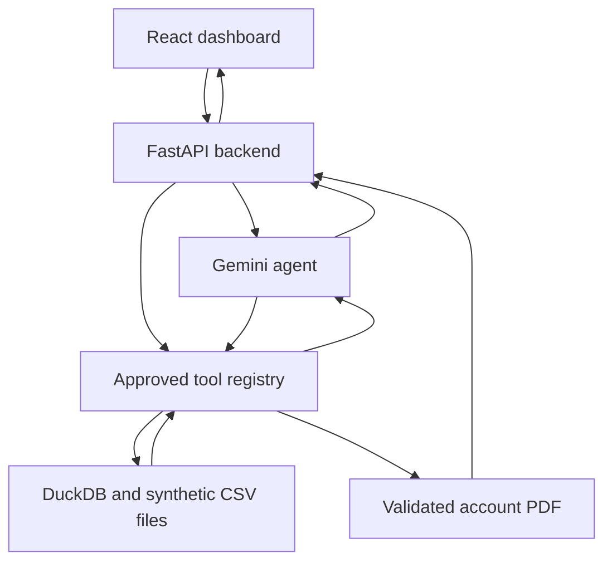

# InsightForge — Banking Intelligence Agent

I built a banking analytics application with Python, Gemini, DuckDB, FastAPI, and React.

[V3.9 release PR](https://github.com/VamshiSamudrala123/ai-engineer-journey/pull/18) · [Passing V3.9 CI run](https://github.com/VamshiSamudrala123/ai-engineer-journey/actions/runs/40591396566) · [Dashboard notes](dashboard/README.md)

## Why I built it

After working on a chatbot and a study planner, I wanted to connect a model to a larger dataset and build something I could explore through a proper interface.

I chose synthetic banking transactions. They gave me room to work with SQL, compare payment activity, and investigate individual accounts. They also pushed me to think carefully about what the numbers actually meant.

I started with the Python analysis tools, connected them to Gemini, and then brought everything into a FastAPI backend and React dashboard. Later, I added conversation context, tool activity, PDF reports, and deployment controls.

## What I built

| Area | What I added |
| --- | --- |
| Overview | I displayed transaction and account counts, the transaction date range, currency counts, and synthetic laundering-label counts. |
| Payment analysis | I compared transaction volumes and label percentages by payment format and currency. |
| Account investigation | I added lookups by bank ID and account number, with incoming, outgoing, self-transfer, and labeled transaction counts. |
| Gemini assistant | I connected natural-language questions to approved tools, supported follow-up questions, and showed tool names and execution statuses. |
| PDF reporting | I generated downloadable account reports from validated investigation results. |

I also added loading states, error messages, question retry, and a New Conversation option.

The overview and payment sections used backend queries, with cached summaries. Account investigations queried the selected account. I kept the featured account card as a static example and labeled it separately.

## How I connected the pieces



I gave Gemini access to three tools:

| Tool | What it returned |
| --- | --- |
| `inspect_banking_data` | Overall dataset statistics and the transaction date range |
| `analyze_payment_formats` | Transaction groups by payment format and currency, including synthetic labels |
| `investigate_account` | Transaction counts for a specific bank and account |

Gemini requested a tool and supplied its arguments. My Python controller checked the request, ran the approved function, and returned the result to the model. The model then requested another tool or explained the findings.

I required a tool call on the first round and limited each investigation to three tool rounds and six tool calls. I also validated arguments and rejected unknown tools. I did not expose arbitrary Python execution, model-written SQL, or model-selected file paths.

For follow-up questions, I passed up to six previous messages back to the agent. The browser held that conversation in memory; a refresh cleared it.

## The stack I used

| Technology | How I used it |
| --- | --- |
| Python and DuckDB | I wrote the analysis tools and queried the CSV data. |
| Google Gemini | I used function calling for tool selection and explanations. |
| FastAPI and Pydantic | I exposed the tools through endpoints and validated requests. |
| React and Vite | I built the dashboard and chat interface. |
| ReportLab | I generated account investigation PDFs. |
| unittest and GitHub Actions | I checked backend behavior and the frontend build. |
| Docker | I prepared a container that built the frontend and served it through FastAPI. |

## The data I worked with

I used the HI-Small transaction and account files from the [IBM Transactions for Anti Money Laundering dataset on Kaggle](https://www.kaggle.com/datasets/ealtman2019/ibm-transactions-for-anti-money-laundering-aml).

I kept the large CSV files outside Git and Docker builds. For local development, I downloaded and extracted the dataset separately, then placed the files at:

- `day-04-insightforge-agent/data/raw/HI-Small_Trans.csv`
- `day-04-insightforge-agent/data/raw/HI-Small_accounts.csv`

For an external data directory, I supported `INSIGHTFORGE_DATA_DIR` as an absolute path containing those same filenames. I set it before starting the backend.

All records were synthetic. I treated the generated laundering labels as dataset annotations, rather than evidence of real-world wrongdoing. I did not build or evaluate a fraud detection model.

## How I ran it locally

I used Python 3.12 and Node.js 22, matching the CI configuration. The commands below captured my setup from the repository root on macOS or Linux.

### Backend

I created a virtual environment and installed the backend dependencies:

```bash
python3 -m venv .venv
source .venv/bin/activate
python -m pip install -r day-04-insightforge-agent/requirements.txt
```

After placing the CSV files in the paths above, I created a private `day-04-insightforge-agent/.env` file for Gemini:

```dotenv
GEMINI_API_KEY=your_api_key_here
```

I kept the key on the backend and excluded the file from Git. I also supported an optional `GEMINI_MODEL` setting for selecting an available function-calling model.

I started the backend with:

```bash
cd day-04-insightforge-agent
python -m uvicorn api:app --reload --host 127.0.0.1 --port 8000
```

I checked the server at [the health endpoint](http://127.0.0.1:8000/api/health). That check confirmed the server responded; it did not validate the CSV files or Gemini access. The analytics pages worked without a Gemini key once the data was available.

### Dashboard

In a second terminal, from the repository root, I ran:

```bash
cd day-04-insightforge-agent/dashboard
npm ci
npm run dev
```

I opened [the dashboard](http://127.0.0.1:5173/). Vite forwarded `/api` requests to FastAPI on port 8000.

### Questions I used to explore the tools

I tried questions such as “Summarize the banking dataset,” “Compare the top payment formats and currencies,” and “Investigate account 8000F4580 at bank 3208.”

For account reports, I used the Account Investigation page and its PDF download button. I generated the report from approved query results and validated the counts before rendering it. Gemini did not supply the report's numerical findings.

## The API I added

| Method | Endpoint | What I used it for |
| --- | --- | --- |
| GET | `/api/health` | I checked server availability. |
| GET | `/api/overview` | I retrieved dataset statistics. |
| GET | `/api/payments` | I retrieved payment group statistics. |
| POST | `/api/accounts/investigate` | I looked up an account. |
| POST | `/api/chat` | I sent a question with bounded conversation history. |
| POST | `/api/reports/account` | I downloaded an account PDF. |

## How I checked the project

I added automated tests for the tools, argument validation, agent loop, API endpoints, conversation handling, PDF reporting, access controls, and dashboard serving.

The [V3.9 release PR](https://github.com/VamshiSamudrala123/ai-engineer-journey/pull/18) recorded 111 passing Python tests. The [CI run for that release](https://github.com/VamshiSamudrala123/ai-engineer-journey/actions/runs/40591396566) also passed the Python checks and React production build.

From the repository root, I used:

```bash
python -m unittest discover -s day-04-insightforge-agent/tests -q
python -m compileall -q day-04-insightforge-agent
```

For the frontend, I ran:

```bash
cd day-04-insightforge-agent/dashboard
npm ci
npm run build
```

The automated checks covered controlled test cases. I treated live Gemini behavior and full-dataset checks as separate verification.

## What I prepared for deployment

In V3.9, I added a multi-stage Dockerfile and configured FastAPI to serve the built dashboard and API from one origin.

I added the following server-side settings:

| Setting | How I used it |
| --- | --- |
| `INSIGHTFORGE_ENV=production` | I enabled the production access gate. |
| `INSIGHTFORGE_ACCESS_USERNAME` | I configured the private demo username. |
| `INSIGHTFORGE_ACCESS_PASSWORD` | I configured a password of at least 16 characters. |
| `INSIGHTFORGE_DATA_DIR` | I pointed the application to an absolute dataset directory. |
| `INSIGHTFORGE_ENABLE_CHAT=true` | I explicitly enabled production chat after configuring access. |
| `GEMINI_API_KEY` | I supplied the backend key when using Gemini. |

Production access failed closed when credentials were missing or invalid. I left only the health endpoint public and kept chat disabled by default. I designed Basic authentication for a private demo behind HTTPS.

I also added in-process chat limits of eight requests per client and thirty globally in a sixty-second window. I kept the container to one worker because those limits lived in process memory.

I had not verified a cloud deployment or a Docker image build for this release. I kept deployment preparation separate from a completed hosted release.

## What I learned and where I stopped

The hardest part was getting the boundaries right: which operations the model could request, how Python checked them, and how results reached the interface without losing their meaning.

Building the frontend and backend together helped me understand that flow much better. Adding PDF reports also made me separate calculated evidence from the model's explanation.

I kept this version focused on three banking tools. I did not add web research, unrestricted SQL, or a trained fraud detection model. Tool activity showed names and statuses, rather than a full execution trace. Conversation history stayed temporary, and some featured content remained static.

By the end of V3.9, I had brought the analysis tools, Gemini agent, dashboard, reporting, and automated checks together in one project.
